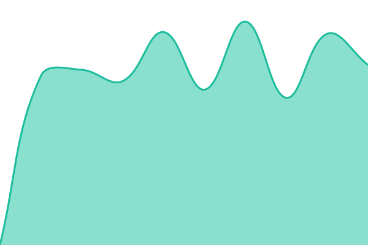
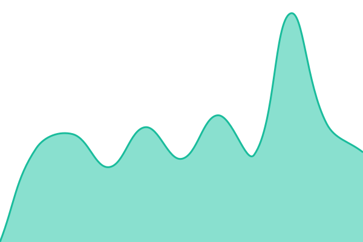

# [📈 Live Status](https://status.icf-essen.de): <!--live status--> **Alle Dienste sind erreichbar**

This repository contains the open-source uptime monitor and status page for [icf-essen](https://status.icf-essen.de), powered by [Upptime](https://github.com/upptime/upptime).

With [Upptime](https://upptime.js.org), you can get your own unlimited and free uptime monitor and status page, powered entirely by a GitHub repository. We use [Issues](https://github.com/icf-essen/status/issues) as incident reports, [Actions](https://github.com/icf-essen/status/actions) as uptime monitors, and [Pages](https://status.icf-essen.de) for the status page.

<!--start: status pages-->
<!-- This summary is generated by Upptime (https://github.com/upptime/upptime) -->
<!-- Do not edit this manually, your changes will be overwritten -->
<!-- prettier-ignore -->
| URL | Status | History | Response Time | Uptime |
| --- | ------ | ------- | ------------- | ------ |
|  [Nextcloud](https://cloud.icf-essen.de/status.php) | Erreichbar | [nextcloud.yml](https://github.com/icf-essen/status/commits/HEAD/history/nextcloud.yml) | 

 705ms
     
 | 

<a href="https://status.icf-essen.de/history/nextcloud">100.00%</a>
    

|  [Vaultwarden](https://vault.icf-essen.de/alive) | Erreichbar | [vaultwarden.yml](https://github.com/icf-essen/status/commits/HEAD/history/vaultwarden.yml) | 

 562ms
     
 | 

<a href="https://status.icf-essen.de/history/vaultwarden">100.00%</a>
    

|  [Anmeldung (Authentik)](https://auth.icf-essen.de/-/health/live/) | Erreichbar | [anmeldung-authentik.yml](https://github.com/icf-essen/status/commits/HEAD/history/anmeldung-authentik.yml) | 

 727ms
     
 | 

<a href="https://status.icf-essen.de/history/anmeldung-authentik">100.00%</a>
    

|  [Helpdesk (GLPI)](https://helpdesk.icf-essen.de/status.php) | Erreichbar | [helpdesk-glpi.yml](https://github.com/icf-essen/status/commits/HEAD/history/helpdesk-glpi.yml) | 

 715ms
     
 | 

<a href="https://status.icf-essen.de/history/helpdesk-glpi">100.00%</a>
    

|  [Next Step Rad](https://nextstep.icf-essen.de/next-step-rad/api/health) | Erreichbar | [next-step-rad.yml](https://github.com/icf-essen/status/commits/HEAD/history/next-step-rad.yml) | 

 569ms
     
 | 

<a href="https://status.icf-essen.de/history/next-step-rad">100.00%</a>
    

|  [NetBox](https://netbox.icf-essen.de/healthz) | Erreichbar | [net-box.yml](https://github.com/icf-essen/status/commits/HEAD/history/net-box.yml) | 

 541ms
     
 | 

<a href="https://status.icf-essen.de/history/net-box">100.00%</a>
    

|  [Grafana](https://grafana.icf-essen.de/healthz) | Erreichbar | [grafana.yml](https://github.com/icf-essen/status/commits/HEAD/history/grafana.yml) | 

 562ms
     
 | 

<a href="https://status.icf-essen.de/history/grafana">100.00%</a>
    

<!--end: status pages-->

[**Visit our status website →**](https://status.icf-essen.de)

## 📄 License

- Powered by: [Upptime](https://github.com/upptime/upptime)
- Code: [MIT](./LICENSE) © [Anand Chowdhary](https://anandchowdhary.com)
- Data in the `./history` directory: [Open Database License](https://opendatacommons.org/licenses/odbl/1-0/)
